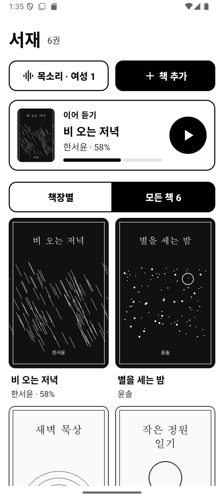
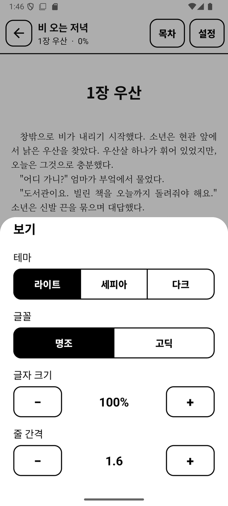
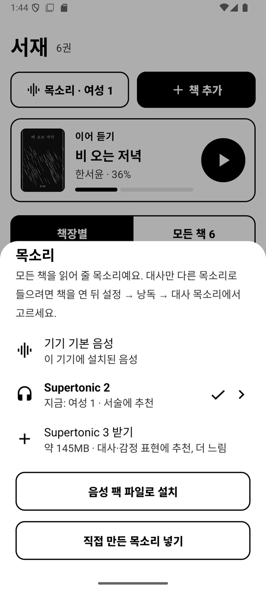
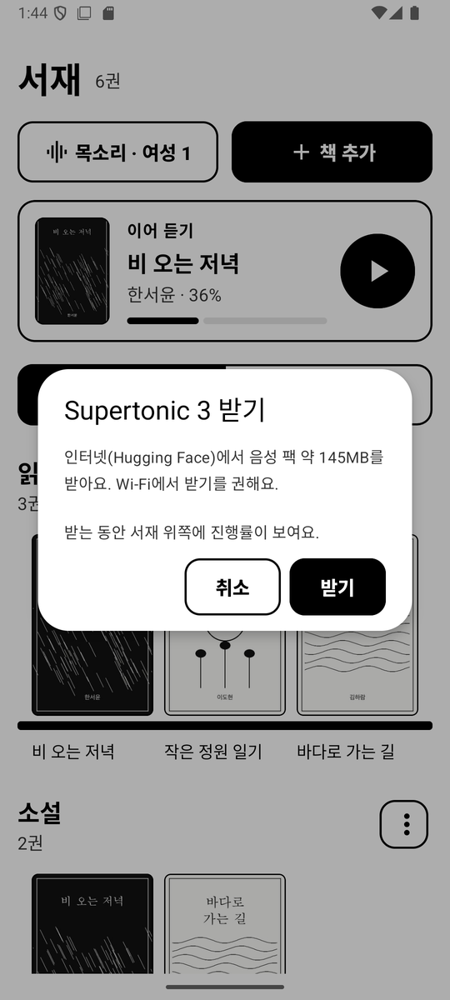
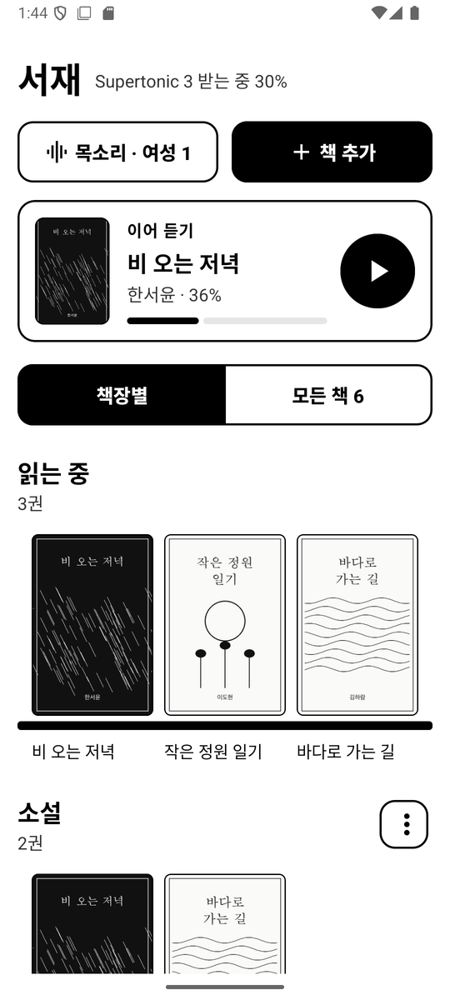

# 보이스 리더 (Voice Reader)

내가 고른 목소리로 EPUB을 읽어 주는 **오프라인 안드로이드 이북 리더**입니다.
한국어를 제대로 읽도록 다듬은 낭독, 고칠 수 있는 발음 사전, 흑백 e-ink 기기에 맞춘 화면이 특징입니다.
개인 사용을 위한 비상업 오픈소스 프로젝트입니다.

> 상태: 개발 초기. 에뮬레이터(Android 16)에서 동작을 확인했고, 실제 e-ink 기기에서는 아직 시험하지 않았습니다.


**[사용 방법](docs/guide.md)**: 책 모으기, 목소리 고르기, 화면 끄고 듣기, 대사만 다른 목소리로, 발음 고치기, 책장 정리, 직접 만든 목소리 넣기를 화면과 함께 단계별로 안내합니다.

## 설치

1. 기기 브라우저에서 [voice-reader.apk](https://github.com/MJ-best/voice-reader/releases/latest/download/voice-reader.apk)를 받습니다([모든 릴리스](https://github.com/MJ-best/voice-reader/releases)).
2. 받은 파일을 열어 설치합니다. 처음 한 번은 '출처를 알 수 없는 앱 설치'를 허용해야 합니다.
3. 앱에서 서재 위쪽 **목소리** 버튼 → **Supertonic 2 받기**로 음성 팩을 받습니다(약 96MB, Wi-Fi 권장).

Android 8.0 이상, arm64 기기에서 동작합니다.

## 화면

<p align="center">
  
  
  
</p>
<p align="center"><sub>서재와 이어 듣기 · 책장별로 보기 · 모든 책</sub></p>

<p align="center">
  
  
  
</p>
<p align="center"><sub>낭독 중(대사는 Supertonic 3, 지문은 Supertonic 2) · 단어를 길게 눌러 발음 고치기 · 발음 추가(이 책만 / 모든 책)</sub></p>

<p align="center">
  
  
  
</p>
<p align="center"><sub>설정(네 갈래, 스크롤 없이) · 보기(테마·글꼴, 크기는 −/+) · 읽기 옵션(켬 | 끔)</sub></p>

<sub>스크린샷의 책과 표지는 데모용으로 직접 만든 것입니다. 선택한 항목은 검게 채워지고, 누르는 순간 반전되어 흑백 e-ink 화면에서도 분명하게 보입니다.</sub>

## 할 수 있는 것

**서재**
- 기기 안의 EPUB을 모두 찾아 원래 위치 그대로 모읍니다(복사하지 않음). 앱을 열 때마다 새 파일만 추가합니다.
- 파일 하나를 골라 가져올 수도 있습니다.
- 책장으로 묶기: 자동 책장(읽는 중, 분류 안 된 책)과 직접 만든 책장. 한 책을 여러 책장에 둘 수 있습니다.
- 이어 듣기 카드: 버튼 하나로 마지막 위치부터 바로 낭독합니다.
- DRM이 걸린 책(LCP, Adobe ADEPT, 그 밖의 암호화)은 열지 않고 알려 줍니다.

**읽기**
- [Readium](https://readium.org/) 기반 본문 표시, 목차, 이어 읽기.
- 테마(라이트·세피아·다크), 글꼴(명조·고딕), 글자 크기, 줄 간격.
- 위쪽 바(책 제목, 장, 진행률)와 아래 재생 바(이전 문장 · 듣기 · 다음 문장)는 늘 같은 자리에 있고 본문을 가리지 않습니다. 가장자리 탭과 기기 페이지 버튼으로 넘김.

**낭독**
- 기기 기본 TTS, 또는 Supertonic 음성 팩([Supertonic](https://huggingface.co/Supertone) · [sherpa-onnx](https://github.com/k2-fsa/sherpa-onnx), 기기 안에서 합성). 음성 팩은 앱에서 바로 받거나 zip으로 가져옵니다.
- 읽는 문장 하이라이트와 페이지 자동 넘김, 백그라운드 재생, 잠금화면·이어폰 버튼, 장 이동.
- 다음 문장을 미리 합성해 끊김 없이 이어 읽습니다. 짧은 문장이 이어지면 묶어서 한 번에 읽어, 문장마다 목소리 높이가 튀지 않습니다.
- 영어로만 된 문장(한국어 책 속 영어 인용문, 언어 정보가 없는 영어책)은 영어로 읽습니다. 영어 단어가 섞인 한국어 문장은 한국어로 읽습니다.
- 대사 목소리: 따옴표로 시작하는 대사만 다른 음성 팩으로 읽습니다(예: 서술은 Supertonic 2, 대사는 Supertonic 3).
- 속도, 문장 사이 쉼(짧게·보통·길게).

**한국어 다듬기**
- 숫자를 단위에 맞게: `3개` → 세 개, `21명` → 스물한 명, `5개월` → 오 개월, `6월` → 유월.
- 날짜, 시간, 단위(km·kg·%), 소수, 전화번호, 영문 약어(AI → 에이아이), 한자 병기.
- 성경 구절: `요 3:16` → 요한복음 삼장 십육절, `시 23:1` → 시편 이십삼편 일절.
- 발음 사전: 본문에서 단어를 길게 누르고 "발음 고치기". 이 책만 / 모든 책. 고치면 바로 다시 읽어 줍니다.
- 읽기 옵션: 괄호 안 내용, 각주 기호, 영문 약어 풀어 읽기를 켜고 끕니다.

**e-ink 기기에 맞춘 화면**
- 순수 흑백. 애니메이션, 그림자, 그라데이션 없이 테두리로 형태를 잡습니다.
- 누르면 즉시 반전(검은 바탕·흰 글씨), 토글은 "켬 | 끔" 칸 나눔 버튼, 슬라이더 대신 −/+ 버튼.
- 큰 글씨(본문 18sp)와 넓은 터치 영역(56~80dp). 아이콘 버튼에는 "이전 문장"처럼 하는 일을 글자로 적었습니다.
- 다른 화면으로 들어가는 줄은 끝에 ›, 고른 항목은 ✓와 굵은 글씨, 확인 창의 주 버튼은 검게 채워 한눈에 구분됩니다.
- 한글 제목과 설명은 띄어쓰기에서만 줄을 바꿉니다("만난 사 / 람들"처럼 낱말 중간에서 끊기지 않음).

## 음성 팩

음성 팩은 APK에 들어 있지 않습니다. 앱에서 바로 받거나, 직접 묶은 zip을 가져옵니다.

### 앱에서 받기

서재 위쪽 **목소리** 버튼 → **Supertonic 2 받기** 또는 **Supertonic 3 받기**.
sherpa-onnx가 변환해 [Hugging Face](https://huggingface.co/csukuangfj2/sherpa-onnx-supertonic-tts-int8-2026-03-06)에 올린 파일을, 앱에 고정해 둔 버전 그대로 받습니다.
받는 동안 서재 위쪽에 진행률이 보이고, 중간에 끊기면 다시 누를 때 다 받은 파일은 건너뛰고 이어 받습니다.

| 음성 팩 | 크기 | 어울리는 곳 |
|---|---|---|
| Supertonic 2 | 약 96MB | 서술(일반 글). 빠르고 톤이 자연스럽습니다 |
| Supertonic 3 | 약 145MB | 대사·감정 표현. 합성이 서너 배 느립니다 |

<p align="center">
  
  
  
</p>

### zip으로 가져오기

sherpa-onnx가 배포하는 Supertonic 모델을 직접 zip으로 묶어 가져올 수도 있습니다.

```bash
curl -LO https://github.com/k2-fsa/sherpa-onnx/releases/download/tts-models/sherpa-onnx-supertonic-tts-int8-2026-03-06.tar.bz2
tar xjf sherpa-onnx-supertonic-tts-int8-2026-03-06.tar.bz2
cd sherpa-onnx-supertonic-tts-int8-2026-03-06 && zip ../supertonic-2.zip *.onnx tts.json unicode_indexer.bin voice.bin LICENSE
```

Supertonic 3은 `sherpa-onnx-supertonic-3-tts-int8-2026-05-11`을 같은 방법으로 묶습니다.
만든 zip을 기기에 옮긴 뒤, **목소리** 버튼 → **음성 팩 파일로 설치**로 설치합니다. zip 파일 이름이 음성 이름이 됩니다.

### 목소리 고르기


음성 팩 행을 누르면 그 팩의 목소리 10종(여성 1~5, 남성 1~5)이 나오고, 누르는 즉시 그 목소리로 바뀌어 한 문장을 들려 줍니다.
대사 목소리도 리더의 설정 → 낭독 → 대사 목소리에서 같은 방법으로 고릅니다.

### 목소리 파일 가져오기

Supertonic Voice Builder 등에서 만든 목소리 파일(`style_ttl`·`style_dp`가 든 JSON)을 설치된 음성 팩에 덧붙일 수 있습니다.
**목소리** 버튼 → **직접 만든 목소리 넣기** → 넣을 음성 팩을 고르면, 그 팩의 목록 맨 끝에 파일 이름으로 추가됩니다.
목소리 파일은 만든 모델 버전과 같은 팩에 넣어야 합니다(Supertonic 2용은 Supertonic 2에).

어떤 모델을 왜 골랐는지는 [spike/RESULTS.md](spike/RESULTS.md)에 정리했습니다(Supertonic 2·3, MMS, Mimic3 비교).

## 빌드

- JDK 17 이상, Android SDK 36(build-tools 35 이상)
- 기기: Android 8.0(API 26) 이상, arm64

```bash
./gradlew assembleDebug        # app/build/outputs/apk/debug/app-debug.apk
./gradlew test                 # 단위 테스트(정규화, 대사 분리, DRM 감지, 기기 검색)
```

| 폴더 | 내용 |
|---|---|
| `app/` | 안드로이드 앱(서재, 리더, 낭독 엔진, 음성 팩) |
| `korean/` | 순수 Kotlin 텍스트 처리: 한국어 정규화, 발음 사전, 대사 분리, 읽기 옵션. 안드로이드 의존성이 없어 iPad·Mac용 Kotlin Multiplatform으로 옮길 수 있습니다 |
| `spike/` | 온디바이스 한국어 TTS 모델 비교 스크립트와 결과 |

## 권한

| 권한 | 쓰는 곳 |
|---|---|
| 모든 파일에 접근 (Android 11+) / 저장소 읽기 (Android 8~10) | 기기 안의 EPUB 찾기. 읽기만 하고, 고치거나 지우거나 기기 밖으로 보내지 않습니다 |
| 포그라운드 서비스(미디어 재생) | 화면을 끈 채 낭독 |
| 절전 해제(wake lock) | 화면을 끈 채 낭독하거나 음성 팩을 받는 동안 CPU가 잠들지 않게 |
| 인터넷 | 음성 팩 받기. 그 밖에는 쓰지 않습니다 |

네트워크는 음성 팩을 받을 때만 씁니다(Hugging Face). 책, 읽기 기록, 발음 사전은 기기 밖으로 보내지 않습니다. 분석·추적 SDK가 없습니다.
"모든 파일에 접근" 권한 때문에 Play 스토어 배포에는 맞지 않으며, 직접 설치(사이드로드)를 전제로 합니다.

## 원칙

- **목소리는 본인 것이거나 명시적 동의를 받은 것만** 씁니다. 음성 팩이나 목소리 파일을 가져올 때 동의를 확인하고, 그 사실을 팩 안에 기록합니다.
  실존 인물(성우·배우·가수 등)의 목소리를 동의 없이 복제한 음성 팩이나 프리셋은 이 저장소에 넣지 않습니다.
- **DRM을 풀지 않습니다.** DRM 없는 EPUB만 지원합니다.
- 상업 배포, 유료 기능, 광고, 서버가 없습니다.

## 라이선스

이 저장소의 코드는 [Apache License 2.0](LICENSE)을 따릅니다.

| 구성 요소 | 라이선스 | 비고 |
|---|---|---|
| [Readium Kotlin Toolkit](https://github.com/readium/kotlin-toolkit) | BSD-3-Clause | 의존성 |
| [sherpa-onnx](https://github.com/k2-fsa/sherpa-onnx) | Apache-2.0 | 의존성 |
| AndroidX, Media3, Material Components | Apache-2.0 | 의존성 |
| Supertonic 모델 가중치 | BigScience OpenRAIL-M | **APK에 포함하지 않음.** 앱이 Hugging Face에서 받거나 직접 묶어 가져옵니다. 쓰는 사람이 사용 제한 조항(동의 없는 사칭 금지 등)을 지켜야 합니다 |
