# 사용 방법

자주 하는 일을 시나리오별로 정리했습니다. 화면은 에뮬레이터에서 데모용 책으로 찍었습니다.

1. [처음 켜고 책 모으기](#1-처음-켜고-책-모으기)
2. [목소리 고르기](#2-목소리-고르기)
3. [듣기: 이어 듣기, 화면 끄고 듣기](#3-듣기-이어-듣기-화면-끄고-듣기)
4. [소설을 두 목소리로 듣기](#4-소설을-두-목소리로-듣기)
5. [잘못 읽는 단어 고치기](#5-잘못-읽는-단어-고치기)
6. [괄호, 각주, 약어 읽기 정하기](#6-괄호-각주-약어-읽기-정하기)
7. [책장으로 정리하기](#7-책장으로-정리하기)
8. [직접 만든 목소리 넣기](#8-직접-만든-목소리-넣기)

---

## 1. 처음 켜고 책 모으기

기기 안 어디에 있든 EPUB을 모두 찾아 서재에 모읍니다. 파일은 복사하지 않고 원래 자리에서 읽습니다.

1. 서재 위쪽 **+ 책 추가** → **기기에서 모두 찾기**.
2. "기기의 EPUB 찾기" 창에서 **설정 열기** → 보이스 리더의 **모든 파일에 접근**을 허용하고 돌아옵니다. 돌아오면 바로 찾기 시작합니다.
3. 그다음부터는 앱을 열 때마다 새로 생긴 파일만 더합니다.

파일 하나만 넣고 싶으면 **파일 하나 고르기**를 쓰세요. 이때는 고른 파일을 서재로 복사합니다.

  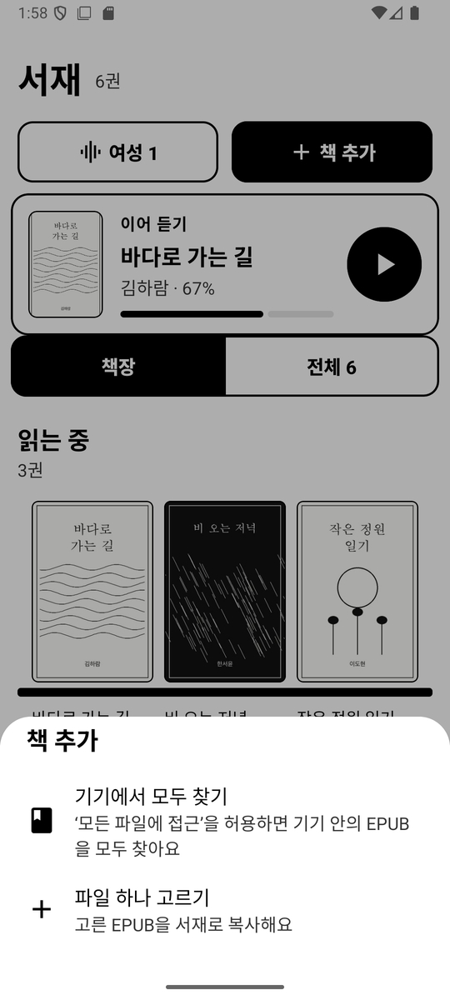
  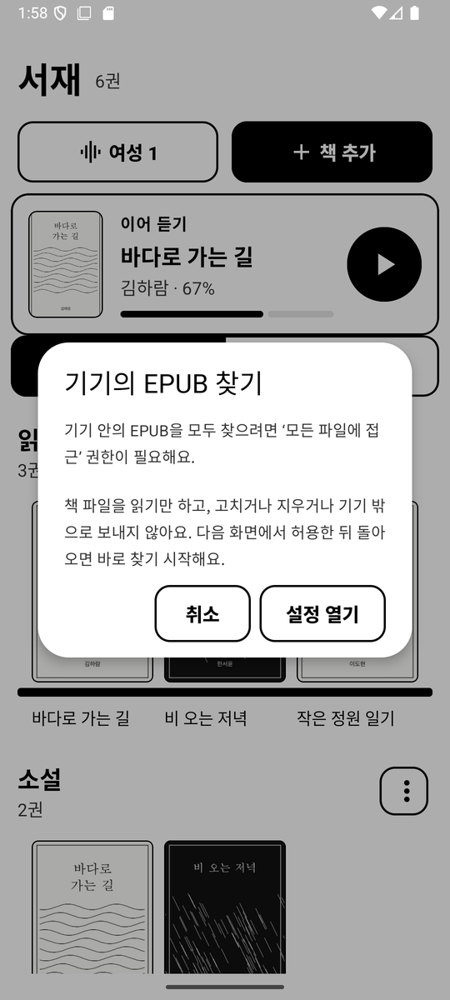
  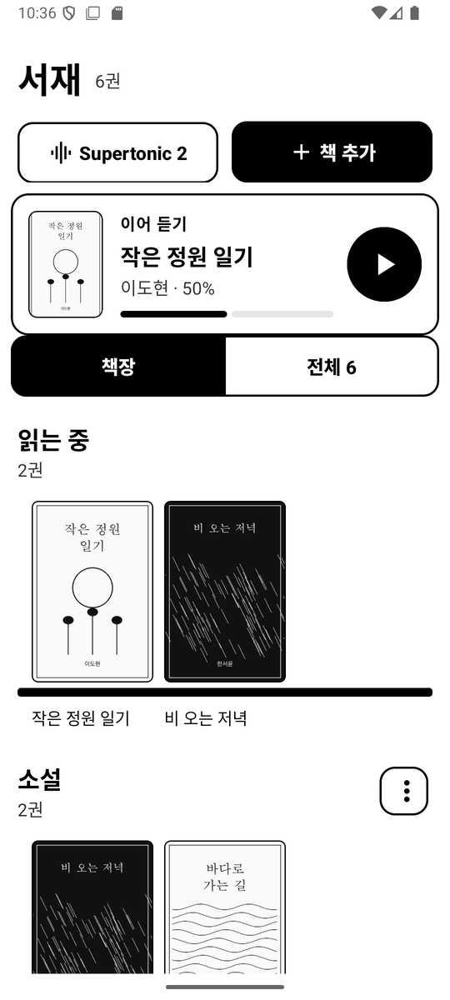

책 추가 · 모든 파일 접근 안내 · 모인 서재

## 2. 목소리 고르기

1. 서재 위쪽의 음성 버튼(지금 목소리 이름이 적힌 버튼)을 누릅니다.
2. 음성 팩이 없으면 **음성 팩 가져오기 (zip)** 로 설치합니다. 목소리 사용 동의를 확인한 뒤 zip을 고릅니다. zip 만드는 법은 [README](../README.md#음성-팩-만들기)에 있습니다.
3. 음성 팩 행을 누르면 목소리 10종(여성 1~5, 남성 1~5)이 나옵니다. 누르는 즉시 그 목소리로 바뀌고 한 문장을 들려 줍니다.

여기서 고른 목소리는 모든 책의 서술에 씁니다. **기기 기본 음성**은 안드로이드에 설치된 TTS를 그대로 씁니다.

  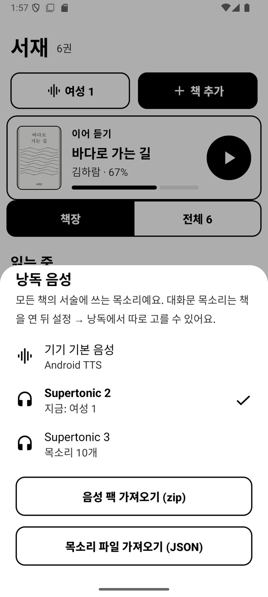
  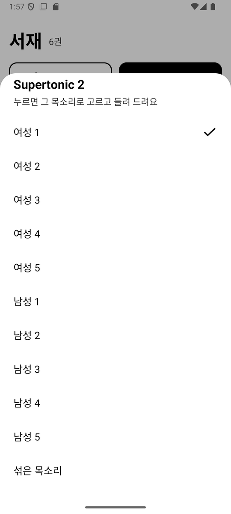

낭독 음성 · 팩 안의 목소리 고르기

## 3. 듣기: 이어 듣기, 화면 끄고 듣기

1. 서재의 **이어 듣기** 카드에서 ▶ 를 누르면 마지막으로 듣던 곳부터 바로 읽습니다.
   책을 열어 듣고 싶으면 표지를 누르고, 화면 가운데를 한 번 눌러 아래 ▶ 를 누릅니다.
2. 읽는 문장이 회색으로 칠해지고, 페이지는 저절로 넘어갑니다. ◀◀ ▶▶ 는 이전·다음 문장입니다.
3. 화면을 끄거나 다른 앱으로 가도 계속 읽습니다. 알림과 잠금화면의 재생 버튼, 이어폰 버튼으로 일시정지·재생하고, 알림의 |◀ ▶| 로 이전·다음 장으로 갑니다.

읽는 위치는 몇 초마다 저장되므로, 다음에 열면 그 자리부터 이어집니다.

> 화면을 끄면 멈춘다면: e-ink 기기(Boox 등)에는 앱마다 '백그라운드에서 얼리기' 같은 절전 설정이 있습니다. 보이스 리더를 그 대상에서 빼 주세요.

  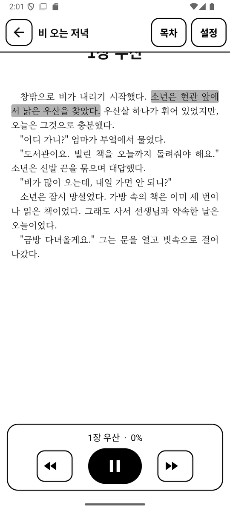
  

  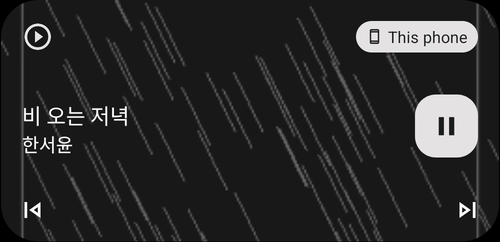

읽는 문장 하이라이트 · 대사는 대화문 목소리로(4번) · 알림의 재생 컨트롤

## 4. 소설을 두 목소리로 듣기

서술은 차분한 목소리로, 따옴표로 시작하는 대사만 다른 목소리로 읽게 할 수 있습니다.

1. 책을 열고 화면 가운데를 눌러 **설정** → **낭독**.
2. **대화문 목소리** → 음성 팩 → 목소리를 고릅니다(예: 서술은 Supertonic 2의 여성 1, 대사는 Supertonic 3의 남성 1). 고르면 바로 들려 줍니다.
3. 이 설정은 그 책에만 적용됩니다. 다시 한 목소리로 읽으려면 **서술과 같은 목소리**를 고르세요.

같은 화면에서 **속도**(−/+)와 **문장 사이 쉼**(짧게·보통·길게)도 바꿀 수 있습니다.

  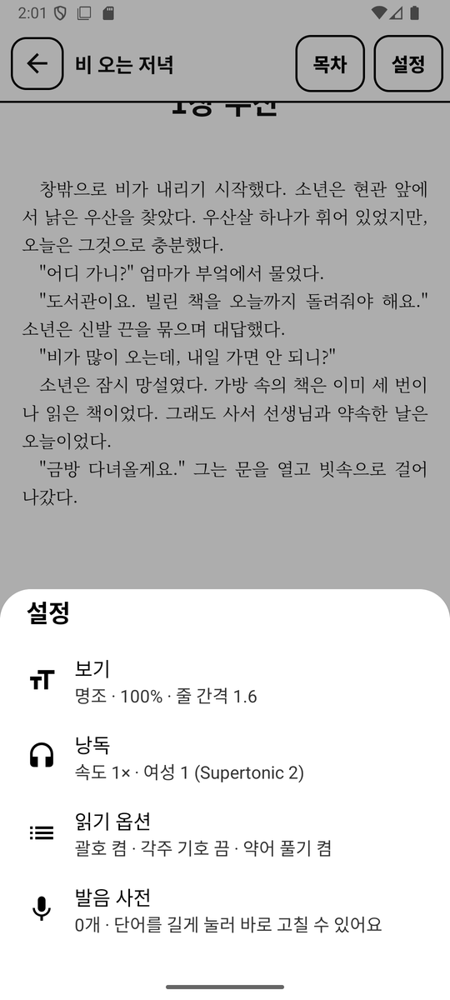
  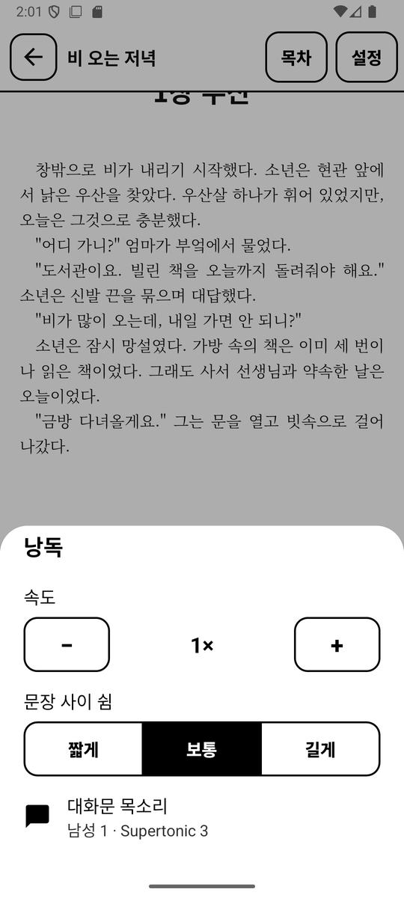
  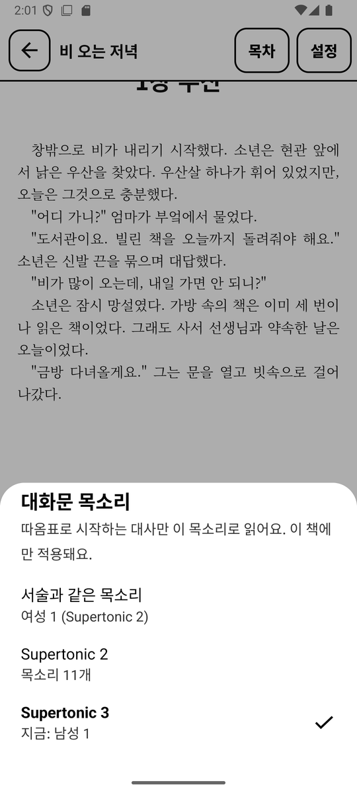

설정 · 낭독 · 대화문 목소리

## 5. 잘못 읽는 단어 고치기

1. 본문에서 잘못 읽는 단어를 길게 눌러 선택하고, 메뉴에서 **발음 고치기**를 누릅니다.
2. **읽는 법**에 소리 나는 대로 적고, **이 책만** 또는 **모든 책**을 골라 저장합니다. 낭독 중이면 그 문장을 바로 다시 읽어 줍니다.
3. 고친 목록은 **설정 → 발음 사전**에서 보고, 고치거나 지울 수 있습니다.

  
  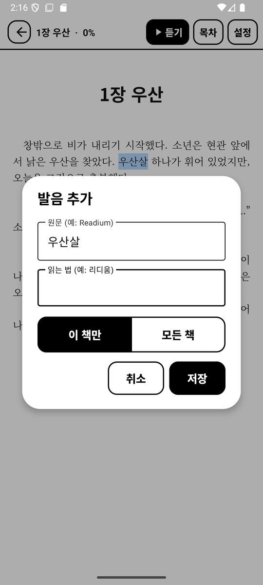

단어를 길게 눌러 발음 고치기 · 읽는 법 적기

## 6. 괄호, 각주, 약어 읽기 정하기

**설정 → 읽기 옵션**에서 켬 | 끔으로 고릅니다. 모든 책에 적용됩니다.

| 옵션 | 켜면 | 끄면 |
|---|---|---|
| 괄호 안 내용 읽기 | ( )나 [ ] 안의 설명까지 읽음 | 괄호 안은 건너뜀 |
| 각주 기호 읽기 | ¹, [1], * 같은 표시도 읽음 | 표시는 건너뜀 |
| 영문 약어 풀어 읽기 | AI → 에이아이, TTS → 티티에스 | 엔진이 읽는 대로 둠 |

  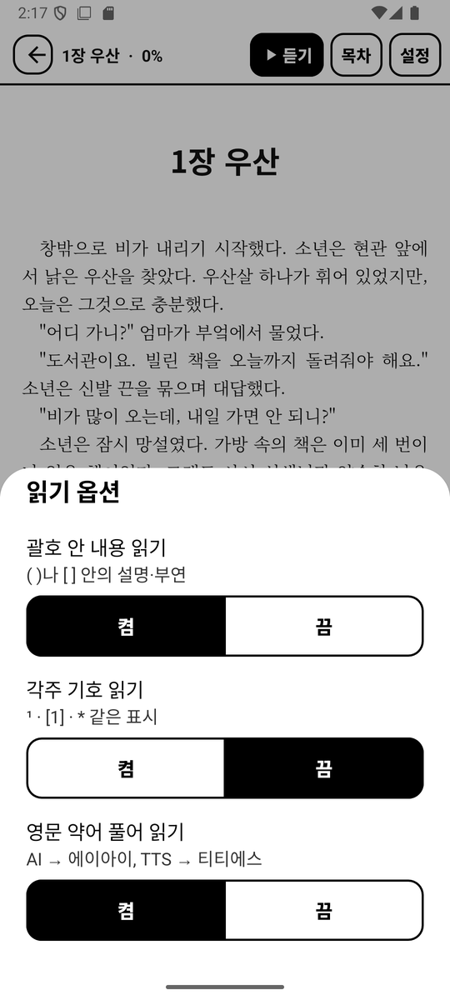

## 7. 책장으로 정리하기

**읽는 중**과 **분류 안 된 책**은 저절로 묶이고, 그 밖의 책장은 직접 만듭니다. 한 책을 여러 책장에 둘 수 있습니다.

1. 책 표지를 길게 누르고 **책장 정하기**를 고릅니다.
2. 넣을 책장을 모두 체크합니다. 새 책장이 필요하면 **새 책장 만들어 넣기**.
3. 책장 이름 옆 ⋮ 에서 책 넣고 빼기, 이름 바꾸기, 책장 지우기를 합니다. 책장을 지워도 책은 서재에 남습니다.

  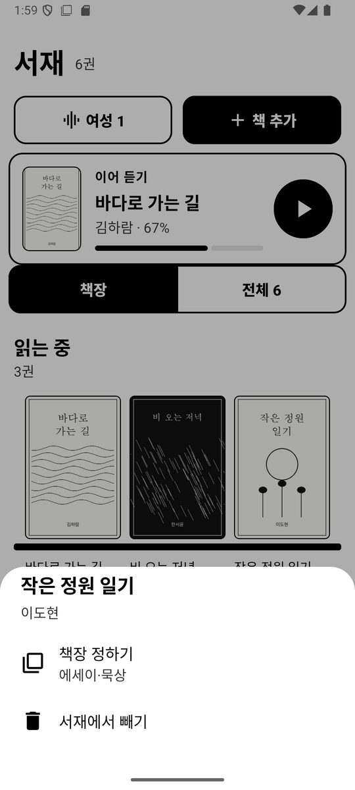
  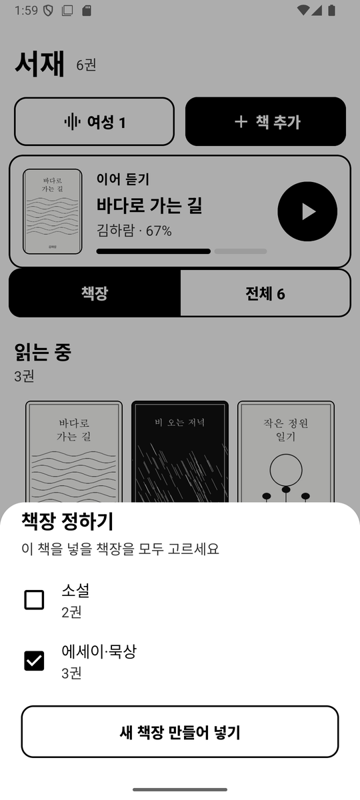
  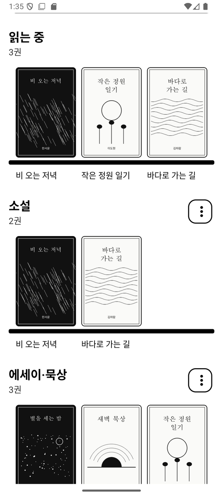

책 길게 누르기 · 책장 고르기 · 책장별로 모인 서재

## 8. 직접 만든 목소리 넣기

Supertonic Voice Builder 등에서 만든 목소리 파일(`style_ttl`·`style_dp`가 든 JSON)을 설치된 음성 팩에 더할 수 있습니다.

1. 목소리 파일을 기기에 옮깁니다(예: 다운로드 폴더).
2. 음성 버튼 → **목소리 파일 가져오기 (JSON)** → 동의를 확인하고 파일을 고릅니다.
3. **어느 음성 팩에 넣을까요?** 에서 그 파일을 만든 모델 버전과 같은 팩을 고릅니다.
4. 팩의 목소리 목록 맨 끝에 파일 이름으로 추가됩니다. 누르면 들어 보고 그 목소리로 고릅니다. 대화문 목소리로도 쓸 수 있습니다.

> Supertonic 2와 3은 목소리 공간이 서로 달라서, 2용 파일을 3에 넣으면 오류 없이 들어가지만 엉뚱한 목소리가 납니다.
> 본인 목소리이거나 화자에게 명시적인 동의를 받은 목소리만 넣으세요.

  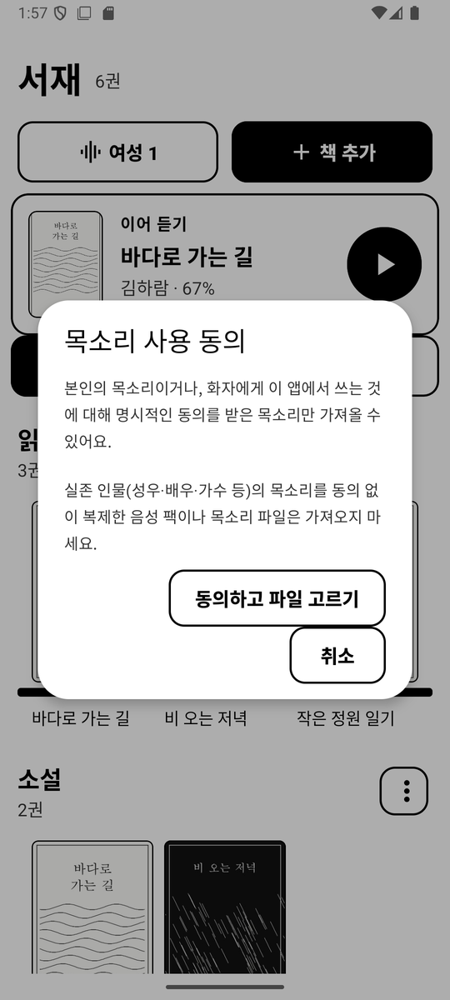
  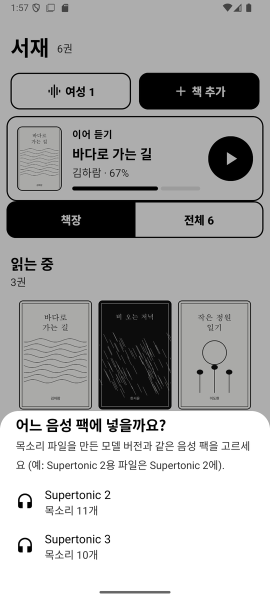
  

동의 확인 · 넣을 팩 고르기 · 목록 맨 끝에 추가됨

